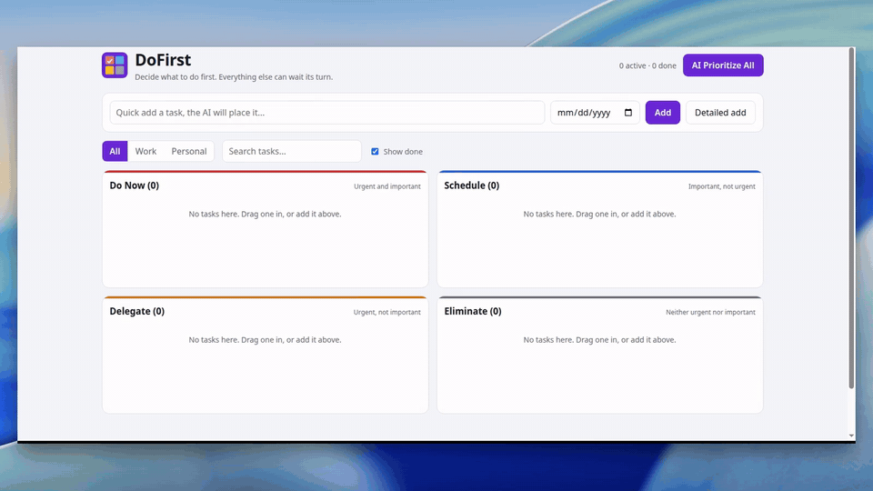

# DoFirst: Task Prioritization Matrix with AI Scoring



[Watch the demo as an MP4 video](demo.mp4)

DoFirst is a task prioritization app.
Use DoFirst for personal tasks and for work tasks.
DoFirst puts each task on a matrix with four quadrants.
You see which tasks to do now, which tasks to schedule, which tasks to delegate, and which tasks to drop.

You place a task manually, or the AI scoring engine places the task for you.
The engine reads the description and uses the due date, impact, importance, and criticality.
The engine gives a score from 0 to 100 and a reason for the placement.
Drag the task to a different quadrant if you do not agree.
Your placement replaces the engine placement.

DoFirst runs on your computer.
DoFirst has no npm dependencies and needs no API keys.
DoFirst saves your tasks in a file on your computer.

## The matrix

| Quadrant | Meaning | Example |
| --- | --- | --- |
| **Do Now** | Urgent and important. Do this task first. | Fix a production outage due today |
| **Schedule** | Important, with no near deadline. Set a date for this task. | Plan the roadmap for next quarter |
| **Delegate** | Urgent, and another person can do it. Give this task to that person. | Book a meeting room for tomorrow |
| **Eliminate** | Low urgency and low importance. Drop this task, or keep it in this quadrant. | Read an old report again |

## Main functions

- Drag and drop a task card between quadrants. Each card also has a move menu for touch screens.
- Quick add: enter a title and a due date. The engine places the task.
- Detailed add: enter a description, a context, and ratings for impact, importance, and criticality.
- Manual placement or AI placement, task by task.
- AI score on each scored card. Hover on a card to see the reasoning text in a tooltip.
- **AI Place** scores one task again. **AI Prioritize All** scores all active tasks again.
- Filters for Work and Personal, a search field, and a control to show or hide done tasks.
- Edit, complete, and delete controls on each card.
- Automatic save to a data file on your computer.

## Quick start

You need Node.js 18 or a later version.

1. Open a terminal.
2. Enter this command:

   ```bash
   npx degit baner29/ai-apps/dofirst dofirst-app
   ```

3. Enter `cd dofirst-app`.
4. Enter `npm start`.
5. Open [http://127.0.0.1:4173](http://127.0.0.1:4173) in your browser.
6. Enter a task title in the quick-add bar and click **Add**.

For the other installation methods, read [doc/installation.md](doc/installation.md).
The methods are: clone the repository, and install the `dofirst` command.

## Run DoFirst on a managed platform

The file `standalone.html` contains the complete app in one HTML file.
Use this file on a managed AI hosting platform.
The app saves tasks in the browser storage of that platform.

Platforms with managed hosting: Anthropic Claude (Artifacts), OpenAI ChatGPT (Sites), Google Gemini (Canvas), xAI Grok (Build Mode), Meta Muse (Spaces), Perplexity (Computer), Lovable, Bolt.new, Replit, v0 by Vercel, Base44, and Taskade (Genesis).
Microsoft Copilot Pages has a limited function for this app.

For the steps for each platform, read [doc/managed-hosting.md](doc/managed-hosting.md).

## Talk to your AI assistant

When DoFirst runs inside your AI platform, you add tasks with natural language.
You do not open the board first.

1. Open your AI app, for example Gemini or Claude.
2. Say or type the task in plain words.
   Example: "Add a task: call the client about the contract, due tomorrow, high impact."
3. The assistant adds the task to DoFirst.
4. The scoring engine sets the score and the quadrant.
5. Open DoFirst in the same AI app to see the board.
6. Drag a task to a different quadrant, edit it, or complete it, as you like.

This flow helps in an urgent moment.
You do not search for a pen and a notebook.
You do not open a separate notes app.
You do not copy the note into a task list later.
You do not prioritize the task by hand.

The app and the data live in your account on the AI platform.
You can open the same board from any device with that account.
You keep no server and no database.

## Documentation

| Document | Content |
| --- | --- |
| [doc/installation.md](doc/installation.md) | All installation methods, data file location, update, removal, troubleshooting |
| [doc/managed-hosting.md](doc/managed-hosting.md) | Steps to run DoFirst on each managed AI hosting platform |
| [doc/ai-scoring.md](doc/ai-scoring.md) | Scoring inputs, weights, urgency values, keyword rules, quadrant rules |
| [doc/api-and-data.md](doc/api-and-data.md) | HTTP API, task fields, data file, backup |

## Tech stack

| Part | Technology |
| --- | --- |
| Runtime | Node.js 18 or later, built-in modules only |
| Server | Node.js `http` server in `server.js` |
| User interface | HTML, CSS, and JavaScript in `public/`. No build step |
| Scoring engine | Local rules in `lib/scorer.js`. No network calls |
| Data storage | JSON file. Default location: `~/.dofirst/tasks.json` |
| Command | `bin/dofirst.js`, through the `bin` field in `package.json` |
| Tests | Node.js test runner. Command: `npm test` |

## Project layout

```text
dofirst/
  README.md             This file
  demo.gif              Demo animation, shown at the top of this file
  demo.mp4              The same demo as a video file
  package.json          Package data, scripts, and the command entry
  server.js             HTTP server, API, and data storage
  standalone.html       Complete app in one file, for managed platforms
  bin/dofirst.js        Command-line launcher
  lib/scorer.js         Scoring engine
  public/               Web app files: page, scripts, styles, icons
  doc/                  Full documentation
  test/scorer.test.js   Scoring engine tests
```

## License

DoFirst is part of the [ai-apps](https://github.com/baner29/ai-apps) repository.
The Apache License 2.0 applies.
Read the `LICENSE` file in the repository root.
