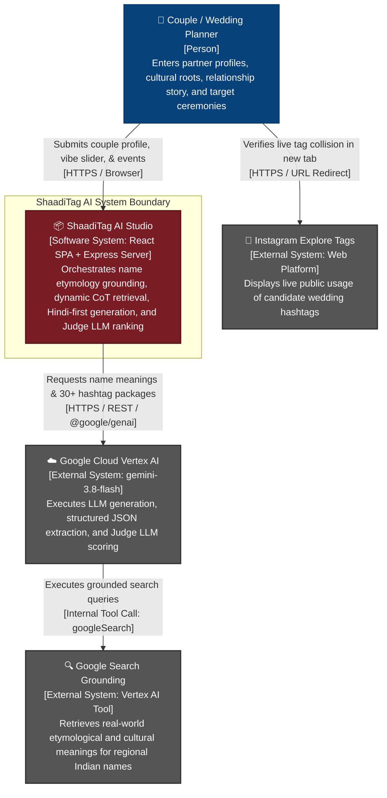
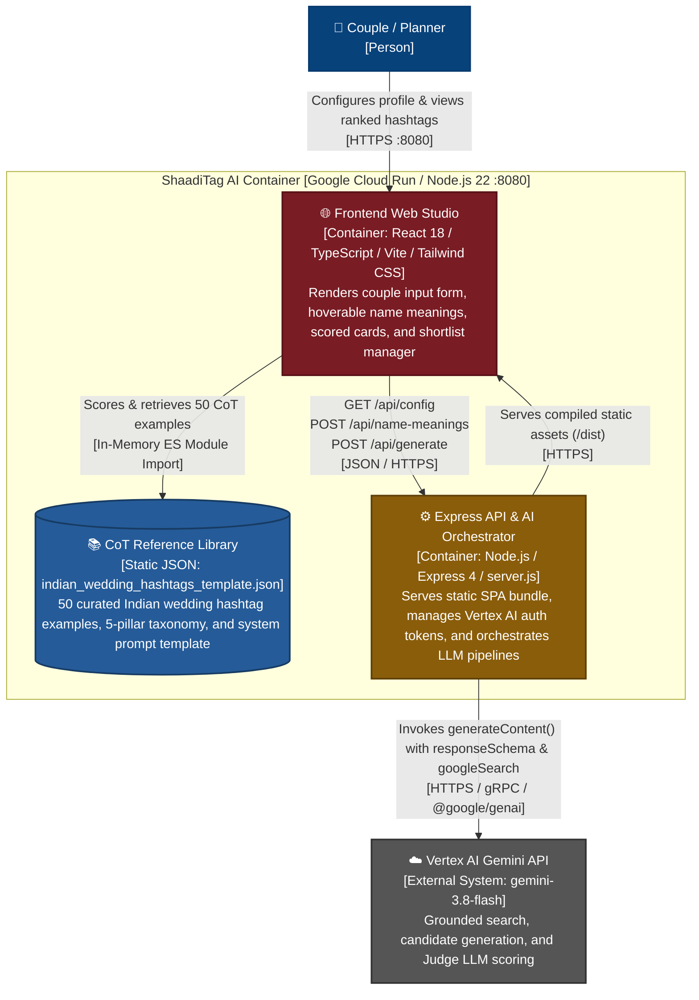
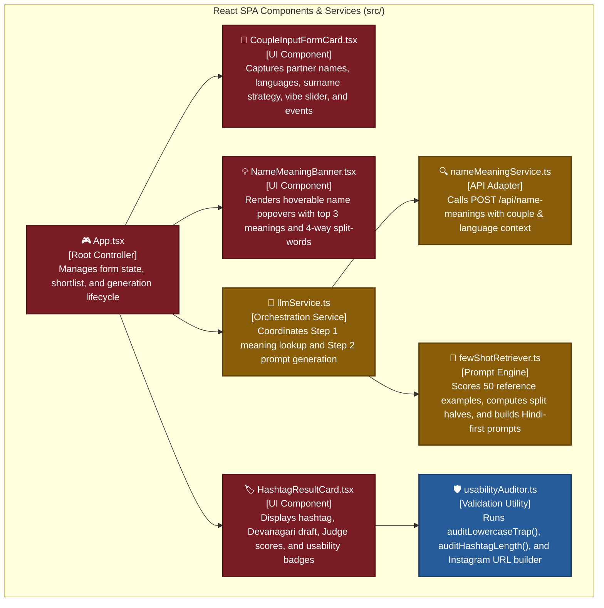
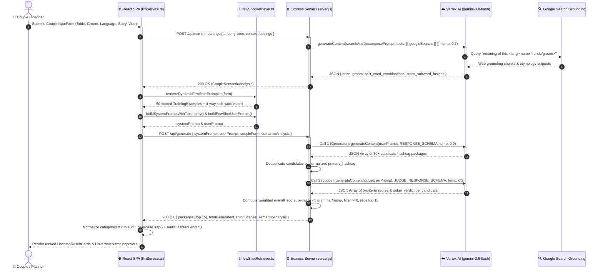
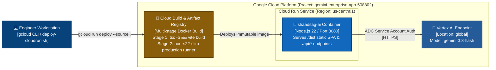

# ShaadiTag AI: System Architecture Specification

## 1. Introduction & Goals

**ShaadiTag AI** is a full-stack web application that generates culturally resonant, grammatically accurate Indian wedding hashtags for couples, families, and wedding planners. Traditional hashtag generators rely on mechanical syllable concatenation (`#RahuPri2026`) or generic templates (`#RahulWedsPriya`), which often produce awkward phonetics, broken Hindi grammar, or unintended English words when rendered in lowercase.

ShaadiTag AI solves this through a three-stage linguistic pipeline powered by Google Cloud Vertex AI (`gemini-3.8-flash`):
1. **Etymological & Sub-Word Grounding**: Queries Google Search Grounding to extract the top 3 cultural meanings of the bride's and groom's names across 10 regional languages, splits both names into syllable halves, and evaluates a 4-way split-word matrix (`[Bride_Half1 + Groom_Half1]`, `[Bride_Half1 + Groom_Half2]`, `[Groom_Half1 + Bride_Half1]`, `[Groom_Half1 + Bride_Half2]`) to detect meaningful Hindi, Urdu, or Sanskrit portmanteaus.
2. **Hindi-First Dynamic Few-Shot Generation**: Retrieves 50 curated Chain-of-Thought (CoT) reference examples ranked by surname similarity, phonetic prefixes/suffixes, cultural roots, and relationship context. The generator model composes 30+ candidates in Devanagari Hindi first to enforce verb-tense and gender agreement before transliterating into PascalCase Roman Hinglish.
3. **LLM-as-a-Judge Quality Filtering & Client Usability Auditing**: A dedicated Judge LLM evaluates all generated candidates across five weighted dimensions (`grammar_correctness`, `name_presence`, `hinglish_usage`, `virality`, and `uniqueness`), disqualifying candidates with verb-tense collisions or hallucinated nicknames, and returns the top 15 ranked packages for client-side lowercase-trap and character-budget auditing.

### Top Quality Goals

| Priority | Quality Goal | Quantifiable Target |
|---|---|---|
| **1** | **Linguistic & Grammatical Accuracy** | 100% of returned hashtags pass Devanagari Hindi verb-tense audits (`grammar_correctness >= 6/10`) and contain explicit bride/groom names or valid split-words (`name_presence >= 6/10`). |
| **2** | **End-to-End Generation Latency** | P95 pipeline completion under 12 seconds across Step 1 (Google Search Grounding) and Step 2 (30-candidate generation + Judge LLM scoring). |
| **3** | **Mobile Guest Usability & Safety** | 0% unintended profanity substrings in lowercase (`auditLowercaseTrap`) and optimal mobile typing length (`<= 22` characters). |

### Stakeholder Matrix

| Role / Stakeholder | Goal / Interest in System | Architectural Expectations |
|---|---|---|
| **Couples & Families** | Memorable, elder-approved, bespoke hashtags that weave in their names, cultural roots, and love story. | Fast interactive UI, accurate regional name etymology, hoverable Hindi/Hinglish translations, and one-click Instagram availability checks. |
| **Wedding Planners & Agencies** | Rapid ideation across multiple ceremonial events (Haldi, Mehendi, Sangeet, Baraat, Pheras, Nikah, Reception). | Tone control via a 4-level Vibe Slider, multi-tag shortlisting, and bulk clipboard export. |
| **AI / Prompt Engineers** | High precision in bilingual wordplay without LLM hallucinations or broken Hindi syntax. | Deterministic JSON schemas (`RESPONSE_SCHEMA`, `JUDGE_RESPONSE_SCHEMA`), Hindi-first CoT prompting, and automated Judge LLM filtering. |
| **Cloud / SRE Engineers** | Stateless, zero-maintenance container deployment on Google Cloud Run. | Multi-stage Docker builds, cached OAuth access tokens (40-minute TTL), and graceful fallback when local CLI tools are absent. |

### User & Business Outcome Translation

| Requirement | Technical Implementation | User & Business Outcome |
|---|---|---|
| **Authentic Bilingual Wordplay** | 4-way split-word matrix evaluation + Devanagari-first composition (`hindi_devanagari_draft`) prior to Hinglish transliteration | Couples receive natural Hindi phrases (such as `#PuriHuiHamariMannat` from Manisha + Natesh) rather than robotic syllable splices. |
| **Zero Hallucinated Nicknames** | Two-pass LLM pipeline where the Judge LLM assigns `name_presence = 0` and caps `overall_score <= 3.0` if unprovided nicknames appear | Eliminates unusable hashtags containing invented pet names, reducing user regeneration retries. |
| **Guest Readability & Safety** | Deterministic client-side `auditLowercaseTrap` and `auditHashtagLength` checks on every card | Prevents embarrassing lowercase letter collisions on wedding signage and keeps tags easy to type on mobile keyboards (`<= 20` chars optimal). |
| **Low-Latency Auth in Dev & Prod** | In-memory 40-minute `gcloud` token cache (`TOKEN_TTL_MS = 2,400,000ms`) with automatic 401 token refresh and Cloud Run ADC fallback | Eliminates `child_process` spawning overhead on sequential API calls while supporting zero-config IAM authentication in Cloud Run. |

---

## 2. Architecture Constraints

### Technical Constraints

| Constraint Area | Specification | Rationale |
|---|---|---|
| **AI Model & Platform** | Google Cloud Vertex AI (`gemini-3.8-flash`) via `@google/genai` SDK (`^1.0.0`) in region `global` | Required for native `googleSearch` tool grounding and structured `responseSchema` JSON enforcement. |
| **Runtime & Framework** | Node.js 22 (`node:22-slim`), Express `^4.21.2` (ES Modules), React `^18.3.1`, TypeScript `~5.7.2`, Vite `^6.1.0` | Unified JavaScript/TypeScript stack allowing a single container to serve both the compiled SPA (`dist/`) and `/api/*` endpoints on port `8080`. |
| **Stateless Execution** | Zero external database or server-side session storage | All couple inputs, semantic analyses, and shortlisted hashtags are managed in client memory during the session to keep Cloud Run instances completely stateless. |
| **Payload Size Limit** | Express JSON body parser capped at `2mb` (`express.json({ limit: '2mb' })`) | Accommodates the full 50-example CoT reference dataset (~103 KB) embedded within the `/api/generate` prompt payload. |

### Organizational & Domain Constraints

- **Strict Name Preservation**: The generator must never substitute a partner's given name with a dictionary synonym or invent an unprovided nickname.
- **5-Pillar Creative Taxonomy**: All generated hashtags must map to one of five domain categories defined in `src/types/hashtag.ts`:
  1. `Bilingual Semantic Portmanteaus & Meaningful Word-Bridges`
  2. `Phonetic Idiom & Pop-Culture Subversions`
  3. `Surname & Identity Double-Entendres`
  4. `Bollywood & Filmy Narrative Mashups`
  5. `Story-Driven, Cross-Cultural & Ritual Action Tags`

---

## 3. System Context & Boundaries

ShaadiTag AI operates as a self-contained web application that mediates between end users (couples and wedding planners) and Google Cloud's generative AI and search ecosystems, plus external social discovery links.

### System Context Diagram



### External Interfaces

| External Entity | Direction | Protocol & Format | Purpose |
|---|---|---|---|
| **Google Cloud Vertex AI (`gemini-3.8-flash`)** | Outbound | HTTPS / JSON via `@google/genai` SDK | Runs three distinct LLM workloads: (1) Name Meaning & Split-Word Decomposition, (2) 30-Candidate Hindi-First Generator, and (3) 5-Criteria Judge Scorer. |
| **Google Search Grounding (`googleSearch`)** | Outbound (via Vertex AI) | Vertex AI Grounding Tool API | Executes queries of the form `meaning of this <language> name '<name>'` across 10 languages (`Hindi`, `English`, `Marathi`, `Tamil`, `Telugu`, `Bengali`, `Sanskrit`, `Punjabi`, `Gujarati`, `Urdu`). |
| **Instagram Tag Explorer** | Outbound (Client Browser) | HTTPS (`GET https://www.instagram.com/explore/tags/<tag>/`) | Allows users to check whether a candidate hashtag is already saturated on Instagram. |

---

## 4. Solution Strategy

- **Two-Phase Linguistic Grounding Before Generation**: Directly prompting an LLM for wedding hashtags produces shallow rhymes. ShaadiTag AI separates **etymological & syllabic discovery** (`POST /api/name-meanings`) from **creative synthesis** (`POST /api/generate`). Step 1 decomposes names into halves and tests all 4 cross-half combinations so Step 2 receives verified Hindi portmanteaus (such as `Man` + `Nat` = `Mannat`).

- **Client-Driven Dynamic Few-Shot Prompt Assembly**: Rather than hardcoding a static prompt on the backend, the frontend (`fewShotRetriever.ts`) scores all 50 curated examples in `indian_wedding_hashtags_template.json` against the active couple profile. It weights exact first names (`+45`), shared surnames (`+35`), common suffixes like `-preet`/`-deep` (`+30`), same initials (`+22`), phonetic 3-letter slices (`+18`), cultural roots (`+12`), and story keywords (`+10`) to construct the complete system and user prompts.

- **Devanagari-First Chain-of-Thought Enforcement**: To prevent broken Hinglish syntax, `RESPONSE_SCHEMA` forces the generator model to output `hindi_devanagari_draft` (Step 1) and `grammar_and_name_audit` (Step 2) before `primary_hashtag` (Step 3). This guarantees that phonetic surname puns replace the exact grammatical verb slot without leaving conflicting past-tense auxiliary verbs.

- **Generate-Then-Rank with an Independent Judge LLM**: Instead of trusting a single high-temperature (`0.9`) creative generation pass, the server generates 30+ candidates and immediately passes deduplicated candidates to a low-temperature (`0.2`) Judge LLM (`scoreAndRankHashtagsWithJudgeLLM`). The Judge scores each tag across 5 criteria, applies strict penalties for missing names or grammar collisions, filters out candidates scoring `< 6` on grammar or name presence, and returns the top 15 results.

---

## 5. System Architecture & Containers

ShaadiTag AI is packaged as a unified container image deployed to Google Cloud Run, comprising a React Single-Page Application (SPA) and a Node.js/Express API backend.

### Container Diagram



### Internal Component Breakdown

#### Frontend Application (`src/`)



| Module Path | Key Exports | Architectural Responsibility |
|---|---|---|
| [`src/App.tsx`](file:///Users/shikhaagrawal/Documents/AI_Projects/ai-apps/shaaditag_ai/src/App.tsx) | `App` | Root state container managing `CoupleInputForm`, `LLMSettings`, `CoupleSemanticAnalysis`, `GeneratedHashtagPackage[]`, and user shortlist actions. |
| [`src/components/CoupleInputFormCard.tsx`](file:///Users/shikhaagrawal/Documents/AI_Projects/ai-apps/shaaditag_ai/src/components/CoupleInputFormCard.tsx) | `CoupleInputFormCard` | Interactive form capturing bride/groom profiles, 10 regional languages, 4 surname strategies, relationship chips, ceremonial events, and the 4-level Vibe Slider (`0` to `3`). |
| [`src/components/HashtagResultCard.tsx`](file:///Users/shikhaagrawal/Documents/AI_Projects/ai-apps/shaaditag_ai/src/components/HashtagResultCard.tsx) | `HashtagResultCard` | Renders individual hashtag packages with hoverable formula breakdowns, quality score badges, companion variations, lowercase trap checks, and Instagram explore links. |
| [`src/components/NameMeaningBanner.tsx`](file:///Users/shikhaagrawal/Documents/AI_Projects/ai-apps/shaaditag_ai/src/components/NameMeaningBanner.tsx) | `HoverableName`, `NameMeaningBanner` | Displays interactive tooltips showing discovered etymological meanings, Devanagari sub-words, and 4-way split-word combinations. |
| [`src/services/nameMeaningService.ts`](file:///Users/shikhaagrawal/Documents/AI_Projects/ai-apps/shaaditag_ai/src/services/nameMeaningService.ts) | `fetchCoupleNameMeanings`, `buildGoogleSearchQuery` | Formats partner name queries and invokes `POST /api/name-meanings`. |
| [`src/services/fewShotRetriever.ts`](file:///Users/shikhaagrawal/Documents/AI_Projects/ai-apps/shaaditag_ai/src/services/fewShotRetriever.ts) | `retrieveDynamicFewShotExamples`, `buildSystemPromptWithTaxonomy`, `buildFewShotUserPrompt` | Scores the 50 dataset examples against couple attributes, computes 2-half name splits, and constructs the Hindi-first system and user prompts. |
| [`src/services/llmService.ts`](file:///Users/shikhaagrawal/Documents/AI_Projects/ai-apps/shaaditag_ai/src/services/llmService.ts) | `generateWeddingHashtags` | Executes the end-to-end client pipeline (Step 1 meaning discovery -> Step 2 prompt assembly & `/api/generate` call -> response normalization). |
| [`src/utils/usabilityAuditor.ts`](file:///Users/shikhaagrawal/Documents/AI_Projects/ai-apps/shaaditag_ai/src/utils/usabilityAuditor.ts) | `auditLowercaseTrap`, `auditHashtagLength`, `getInstagramTagUrl` | Audits candidate hashtags against 14 awkward lowercase substrings and evaluates character length (`<= 20` optimal, `21-22` acceptable, `> 22` long). |
| [`server.js`](file:///Users/shikhaagrawal/Documents/AI_Projects/ai-apps/shaaditag_ai/server.js) | Express App (`:8080`) | Exposes `/api/config`, `/api/name-meanings`, and `/api/generate`; manages `gcloud` access token caching/retry; executes Generator LLM and Judge LLM calls; serves `dist/`. |

---

## 6. Transaction Flow (Runtime)

When a user clicks **Generate Hashtags**, the system executes a multi-stage asynchronous pipeline across the React SPA, the Express server, and Google Cloud Vertex AI.

### End-to-End Hashtag Generation Sequence



### Judge LLM Weighted Scoring & Disqualification Logic

In [`server.js`](file:///Users/shikhaagrawal/Documents/AI_Projects/ai-apps/shaaditag_ai/server.js#L539-L711), `scoreAndRankHashtagsWithJudgeLLM` computes the composite score for each deduplicated candidate using five criteria on a `0` to `10` scale:

$$\text{Overall Score} = \text{round}_{0.1}\Big(0.30 \cdot G + 0.25 \cdot N + 0.20 \cdot H + 0.15 \cdot V + 0.10 \cdot U\Big)$$

Where:
- $G = \text{grammar\_correctness}$ (Weight: **30%**): Evaluates whether `hindi_devanagari_draft` is 100% natural Hindi without verb-tense collisions.
- $N = \text{name\_presence}$ (Weight: **25%**): Verifies explicit inclusion of provided partner names, sub-words, or valid 4-way split-words (scores `0` if names are missing or an unprovided nickname is invented).
- $H = \text{hinglish\_usage}$ (Weight: **20%**): Evaluates natural Roman Hinglish readability and flow.
- $V = \text{virality}$ (Weight: **15%**): Evaluates catchiness, spoken rhythm, and Sangeet backdrop appeal.
- $U = \text{uniqueness}$ (Weight: **10%**): Rewards bespoke split-words and personalized story hooks over generic templates.

**Hard Disqualification Gate**:
1. If $G < 5$ or $N < 5$, `overall_score` is immediately capped at `3.0` (`Math.min(overall_score, 3.0)`).
2. Candidates are sorted by `overall_score` descending and filtered to retain only those where $G \ge 6$ and $N \ge 6$ (returning up to 15 top packages).

---

## 7. Deployment & Infrastructure

ShaadiTag AI is built and deployed as a stateless OCI container on **Google Cloud Run** using a two-stage [`Dockerfile`](file:///Users/shikhaagrawal/Documents/AI_Projects/ai-apps/shaaditag_ai/Dockerfile) and automated deployment script [`deploy-cloudrun.sh`](file:///Users/shikhaagrawal/Documents/AI_Projects/ai-apps/shaaditag_ai/deploy-cloudrun.sh).

### Deployment Topology



### Environment Configuration Reference

| Variable Name | Default Value | Scope | Description |
|---|---|---|---|
| `PORT` | `8080` | Server Runtime | TCP port on which Express listens for HTTP requests. |
| `NODE_ENV` | `production` | Container Build | Optimizes Express and Node.js runtime behavior in the container. |
| `GOOGLE_GENAI_USE_VERTEXAI` | `True` | `@google/genai` SDK | Instructs the SDK to route calls through Google Cloud Vertex AI rather than the consumer Gemini Developer API. |
| `OOGLE_GENAI_USE_VERTEXAI` | `True` | Legacy Compatibility | Fallback environment variable read by `server.js` for typo resilience. |
| `GOOGLE_CLOUD_PROJECT` | `gemini-enterprise-app-508802` | Vertex AI Auth | Target Google Cloud project ID hosting Vertex AI APIs. |
| `GOOGLE_CLOUD_LOCATION` | `global` | Vertex AI Routing | Vertex AI endpoint location used for `gemini-3.8-flash`. |
| `GEMINI_MODEL` | `gemini-3.8-flash` | Model Selection | Default generative model used for grounding, generation, and Judge scoring. |
| `GEMINI_API_KEY` | *(Empty)* | Optional Fallback | Optional Gemini Developer API key when `useVertexAI` is explicitly set to `false`. |

> [!WARNING]
> **Vertex AI Authentication & IAM Permission Risk**: Deploying to Google Cloud Run without granting the Cloud Run runtime service account the `roles/aiplatform.user` IAM role will cause all `/api/name-meanings` and `/api/generate` requests to fail with HTTP 403/500 errors.
> **Required Action**: Ensure the default Compute Engine or custom Cloud Run service account in project `gemini-enterprise-app-508802` has the **Vertex AI User** (`roles/aiplatform.user`) role attached before executing `./deploy-cloudrun.sh`.

---

## 8. Crosscutting Concepts

### Authentication & Token Lifecycle (`server.js`)

The backend supports three authentication modes seamlessly across local development and cloud production:
1. **Local CLI Token Caching**: In local environments where `gcloud` is installed, `getGcloudAccessToken()` executes `gcloud auth print-access-token` with a 5-second timeout and caches the bearer token in memory for **40 minutes** (`TOKEN_TTL_MS = 40 * 60 * 1000`).
2. **Automatic 401 Token Refresh**: `callVertexWithModelFallback()` wraps every Vertex AI call. If Vertex AI returns `401`, `UNAUTHENTICATED`, or `invalid_grant`, the server forces a synchronous token refresh (`createGenAIClient(settings, true)`) and retries the request once automatically.
3. **Cloud Run Application Default Credentials (ADC)**: Inside the `node:22-slim` container where the `gcloud` CLI is not installed, `getGcloudAccessToken()` catches the shell exception and returns `null`, allowing `@google/genai` (`vertexai: true`) to authenticate automatically via the Cloud Run metadata server's Application Default Credentials.

### Structured Output Enforcement & Fallback Handling

- **Strict JSON Schema Validation**: Both `POST /api/generate` (Generator Call) and `scoreAndRankHashtagsWithJudgeLLM` (Judge Call) pass `responseMimeType: 'application/json'` and explicit `@google/genai` `Type` schemas (`RESPONSE_SCHEMA` and `JUDGE_RESPONSE_SCHEMA`). This prevents malformed JSON or missing fields.
- **Grounded Search JSON Extraction**: Because Vertex AI does not permit combining `tools: [{ googleSearch: {} }]` with `responseMimeType: 'application/json'` in the same request, `POST /api/name-meanings` strips markdown fences (` ```json `) and extracts the root JSON object via regex (`cleanedText.match(/\{[\s\S]*\}/)`), populating safe default fallbacks if any sub-array is incomplete.
- **Judge LLM Fault Isolation**: If the second LLM call (`scoreAndRankHashtagsWithJudgeLLM`) encounters a transient timeout or parsing error, the `catch` block logs a warning and returns the first 15 deduplicated candidates from the generator pass rather than failing the user's request.

### Client-Side Safety & Usability Auditing (`usabilityAuditor.ts`)

Every hashtag rendered in `HashtagResultCard.tsx` undergoes deterministic client-side checks:
- **Lowercase Collision Audit (`auditLowercaseTrap`)**: Converts the PascalCase hashtag to all-lowercase (`#sidsnaggedsari`) and scans against 14 prohibited substrings (`anus`, `arse`, `assh`, `shit`, `fuck`, `crap`, `piss`, `dick`, `cock`, `boob`, `slut`, `whore`, `fart`, `poop`). If a match is detected, the UI displays an amber warning instructing the user to insert a ritual or verb separator.
- **Character Budget Audit (`auditHashtagLength`)**: Classifies tag length into three tiers:
  - `optimal` (`<= 20` characters): *"Easy for guests to type"*
  - `acceptable` (`21–22` characters): *"Within 22-char budget"*
  - `long` (`> 22` characters): *"Consider shortening for mobile guests"*

---

## 9. Architecture Decisions

| Decision ID | Decision Title | Selected Approach & Rationale | Status |
|---|---|---|---|
| **ADR-001** | **Two-Stage Hindi-First Generation Pipeline** | Require the generator model to compose `hindi_devanagari_draft` and `grammar_and_name_audit` before producing the Roman Hinglish `primary_hashtag`. Directly generating Hinglish in Roman script leads to broken Hindi postpositions and verb-tense clashes when names are used as phonetic puns. | Accepted |
| **ADR-002** | **Two-Pass Generator + Judge LLM Architecture** | Pair a high-temperature (`0.9`) 30-candidate generator pass with a low-temperature (`0.2`) Judge LLM pass (`scoreAndRankHashtagsWithJudgeLLM`). Creative wordplay requires high sampling temperature, whereas grammatical verification and nickname-hallucination detection require deterministic analytical scoring. | Accepted |
| **ADR-003** | **4-Way Split-Word Matrix Pre-Computation** | Decompose bride and groom names into first and second halves during Step 1 (`/api/name-meanings`) and evaluate all 4 cross-half combinations before Step 2 generation. Pre-computing combinations guarantees that meaningful portmanteaus (such as `Mannat`, `Bandhan`, `Dilbar`, `Sanam`) are systematically discovered rather than left to chance. | Accepted |
| **ADR-004** | **Single-Container Express + Vite SPA Deployment** | Serve both the compiled React SPA (`dist/`) and `/api/*` endpoints from a single Express process on port `8080`. Eliminates CORS preflight complexity in production, simplifies Cloud Run deployment to a single service, and avoids separate CDN/hosting overhead. | Accepted |

---

## 10. Quality Requirements

### Quality Scenarios (Stimulus -> Response)

| Category | Aspect | Stimulus | Architectural Mechanism | Quantifiable Response |
|---|---|---|---|---|
| **Accuracy** | **Hindi Verb-Tense Integrity** | User enters a surname that sounds like a continuous Hindi verb (e.g., `"Gogna"` or `"Soti"`). | `RESPONSE_SCHEMA` requires `hindi_devanagari_draft` first; Judge LLM penalizes conflicting auxiliary verbs with `grammar_correctness <= 2`. | Candidate with conflicting auxiliary verb is capped at `overall_score <= 3.0` and filtered out of the top 15 results. |
| **Accuracy** | **Zero Nickname Hallucination** | User leaves `bride.nickname` and `groom.nickname` blank in `CoupleInputFormCard`. | Prompt explicitly injects `NONE PROVIDED — DO NOT invent any random nickname`; Judge LLM scores `name_presence = 0` for invented nicknames. | 100% of returned hashtags use only the provided first names, last names, or direct letter splits. |
| **Performance** | **Repeated Local/Dev API Calls** | Developer or user triggers 10 consecutive hashtag generations within 30 minutes. | `getGcloudAccessToken()` serves the cached OAuth token from memory (`TOKEN_TTL_MS = 40 min`). | 0ms CLI token acquisition overhead on calls 2 through 10. |
| **Reliability** | **OAuth Token Expiration** | Cached `gcloud` token expires after 60 minutes, causing Vertex AI to return `401 UNAUTHENTICATED`. | `callVertexWithModelFallback()` catches `401` / `UNAUTHENTICATED`, forces a fresh token lookup (`forceTokenRefresh = true`), and retries. | Request succeeds transparently on retry with zero user-visible errors. |
| **Resilience** | **Judge LLM Timeout / Failure** | Vertex AI Judge call fails or returns unparseable output during Step 2B. | `try / catch` block in `scoreAndRankHashtagsWithJudgeLLM` falls back to `uniqueCandidates.slice(0, 15)`. | User still receives 15 valid deduplicated hashtags from Step 2A with HTTP 200. |

---

## 11. Risks & Mitigations

| Risk / Technical Debt Item | Likelihood | Impact | Mitigation Strategy |
|---|---|---|---|
| **Sequential Multi-LLM Call Latency**: Executing `/api/name-meanings` (with Google Search) followed by `/api/generate` (Generator LLM + Judge LLM) chains 3 sequential Vertex AI requests. | High | Medium | Cache `CoupleSemanticAnalysis` in React state (`semanticAnalysis`) when only non-name parameters change, and use `gemini-3.8-flash` on the `global` endpoint for low time-to-first-token. |
| **Prompt Payload Size Growth**: Passing all 50 training examples (`~103 KB` JSON) in `buildFewShotUserPrompt` increases input token consumption per generation call. | Medium | Low | `retrieveDynamicFewShotExamples` already computes `topRelevant` (top 10) and `categoryRepresentatives`; if token budgets tighten, slice `allExamples` to the top 15 scored examples instead of all 50. |
| **Google Search Grounding Non-Determinism**: `/api/name-meanings` cannot use `responseSchema` alongside `tools: [{ googleSearch: {} }]`, relying on regex JSON extraction. | Low | Medium | Enforce strict JSON structure instructions in `searchAndDecomposePrompt` and provide deterministic fallback arrays for `top_3_meanings`, `subword_parts`, and `split_word_combinations` in `server.js`. |
| **Unauthenticated Public API Endpoints**: Cloud Run service is deployed with `--allow-unauthenticated` and wildcard CORS (`Access-Control-Allow-Origin: *`). | Medium | High | Add rate limiting (`express-rate-limit` per IP) and Google Cloud Armor or Firebase App Check before exposing the service to high-volume public traffic. |

---

## 12. Glossary

| Term | Definition |
|---|---|
| **4-Way Split-Word Matrix** | Linguistic technique that splits the bride's and groom's first names into two halves each (`FirstHalf`, `SecondHalf`) and tests all four cross-combinations (`B1+G1`, `B1+G2`, `G1+B1`, `G1+B2`) to discover real Hindi, Urdu, or Sanskrit words (such as `Man` + `Nat` = `Mannat`). |
| **Bilingual Semantic Synthesis** | Creative archetype (`1_bilingual_semantic_synthesis`) that discovers real Indian-language words embedded inside a couple's names rather than relying on mechanical syllable splicing. |
| **Contrastive Evaluation** | Quality check included in reference examples comparing the winning creative hashtag against a rejected `naive_concatenation_rejected` tag (`#GroomWedsBride`) and `shallow_wordplay_rejected` tag. |
| **Hindi-First Workflow** | Two-stage generation rule requiring the LLM to compose and grammar-audit the wedding phrase in Devanagari Hindi (`hindi_devanagari_draft`) before transliterating it into Roman Hinglish (`primary_hashtag`). |
| **Judge LLM** | Second Vertex AI invocation (`scoreAndRankHashtagsWithJudgeLLM` at `temperature: 0.2`) that scores all 30+ generated candidates across `virality`, `uniqueness`, `grammar_correctness`, `hinglish_usage`, and `name_presence`. |
| **Lowercase Trap Check** | Client-side validation (`auditLowercaseTrap`) that renders a PascalCase hashtag in all-lowercase to verify that adjacent word boundaries do not accidentally spell profane or awkward substrings. |
| **Phonetic Climax Subversion** | Creative archetype (`3_phonetic_climax_subversion`) that places a partner's name or surname on the final stressed beat of a familiar English idiom or Bollywood movie hook (such as `#RidhiSetGogna` or `#GillTohPagalHai`). |
| **Vibe Slider** | 4-level tone selector (`0`: Poetic & Traditional, `1`: Witty & Punny, `2`: Filmy Bollywood, `3`: Unfiltered Party) that steers the emotional register of generated hashtags. |
